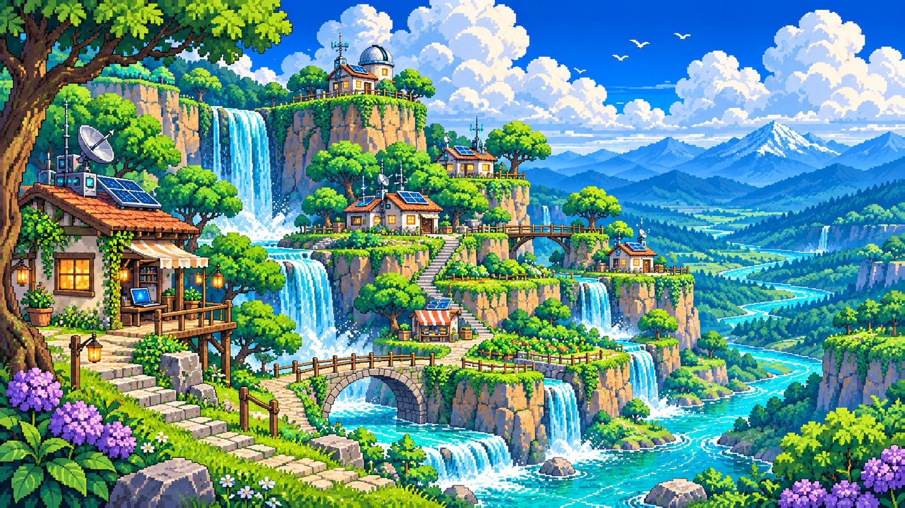

  <a href="https://imon.com.bd/">
    <picture>
      <source media="(prefers-reduced-motion: reduce)" srcset="assets/pixel-hero.svg">
      
    </picture>
  </a>

  <a href="https://imon.com.bd/" aria-label="Enter IMON World">
    <picture>
      <source media="(prefers-reduced-motion: reduce)" srcset="assets/enter-world.png">
      
    </picture>
  </a>

   
  Yes, there are playable games inside. Pick a side quest and chase a high score.

  <a href="https://imon.com.bd/"><strong>Explore my world ↗</strong></a>
  &nbsp; · &nbsp;
  <a href="https://imon.com.bd/#projects">Selected projects</a>
  &nbsp; · &nbsp;
  <a href="https://imon.com.bd/#arcade">Play the arcade</a>
  &nbsp; · &nbsp;
  <a href="https://linkedin.com/in/sabbirimon">LinkedIn</a>

### Choose your world

A little preview of the live site. Pick a landscape to enter it.

<table>
  <tr>
    <td align="center" width="33%"><a href="https://imon.com.bd/?scene=waterfall-valley"> <strong>Waterfall Valley ↗</strong></a> Bright skies · Living landscapes</td>
    <td align="center" width="33%"><a href="https://imon.com.bd/?scene=twilight-lake"> <strong>Twilight Lake ↗</strong></a> Golden skies · Mountain reflections</td>
    <td align="center" width="33%"><a href="https://imon.com.bd/?scene=neon-forest"> <strong>Neon Forest ↗</strong></a> Glowing woods · Firefly nights</td>
  </tr>
</table>

**[Explore 33 scenery presets](https://imon.com.bd/)** · **[Play the arcade](https://imon.com.bd/#arcade)** · **[Build your world in Gridworks](https://imon.com.bd/gridworks/)**

## IMON · Let’s Code Together

### Hey, I'm Sabbir Hassan Imon 👋

An open-source builder from **Dhaka, Bangladesh**, exploring the space between **local-first AI, Android, systems, and cloud infrastructure**. I like useful tools, curious experiments, and giving serious software a little personality.

My roots are in DevOps and networking: Linux, containers, Kubernetes, and the radio networks that connect us. These days, my public projects also explore device tooling, recovery, and experimental model execution.

### A few things I'm building

| Project | What it explores | Built with |
| :--- | :--- | :--- |
| [**Meshlit**](https://github.com/sabbirimon/meshlit) | Local-first AI chat, coding workspaces, and bots for Android and desktop. | Kotlin |
| [**OmniCast**](https://github.com/sabbirimon/OmniCast) | Mirror, control, and record Android over USB or Wi-Fi, with desktop device tools. | Kotlin |
| [**OmniRecovery**](https://github.com/sabbirimon/OmniRecovery) | Cross-platform data recovery, verified USB acquisition, and forensic inspection. | Rust |
| [**HyperL**](https://github.com/sabbirimon/HyperL) | Experimental model execution, sharding, and heterogeneous compute. | Kotlin |

[Browse my public repositories →](https://github.com/sabbirimon?tab=repositories)

### My toolkit

**Code** &nbsp; `Kotlin` · `Rust` · `Python` · `JavaScript` · `Shell` 
**Infrastructure** &nbsp; `Linux` · `Docker` · `Kubernetes` · `GitHub Actions` 
**Always exploring** &nbsp; Local AI · Android · Cloud · RAN / SDN · GSM / LTE / 5G

### Take a play break

**[IMON Gridworks](https://imon.com.bd/gridworks/)** — build power plants, communication networks, data centers, and connected cities in a full-screen management campaign.

**[Pixel arcade](https://imon.com.bd/#arcade)** — Snake · Surf · Ludo with computer opponents · 2048 · Dev Slots · IMON Rally.

**[Daily Tech Quest](https://imon.com.bd/#news)** — fresh tech MCQs in 5, 20, or 30-question rounds, scores, and live tech, science & space news.

Explore animated pixel worlds with local-time lighting and customizable colors. Try light or heavy rain, snow, lightning, clouds, wind, fog, and fireflies from the weather controls, or preview them in World Studio. Tune the intensity, density, and strength—or pause the animation. Music and ambience start off, with optional generated weather sounds and a volume control. Games support keyboard and touch, with personal progress saved on your device.

**[Enter World Studio →](https://imon.com.bd/)** · **[Try Cyberpunk mode →](https://imon.com.bd/?world=cyberpunk)**

Dev Slots uses free virtual collectibles; there are no purchases, cash stakes, or real-world prizes.

### Find me around the internet

[LinkedIn](https://linkedin.com/in/sabbirimon) · [Facebook](https://www.facebook.com/mr.sabbirimon/) · [Medium](https://medium.com/@sabbirimon) · [YouTube](https://youtube.com/@sabbirimon) · [X](https://x.com/sabbirimon) · [Buy me a coffee](https://buymeacoffee.com/sabbirimon)

Built with curiosity. Shared in the open. A little more colorful every day.

WhatsApp: **@imons** · [Facebook](https://www.facebook.com/mr.sabbirimon/)
