

  <a href="https://imon.com.bd/">
    <picture>
      <source media="(prefers-reduced-motion: reduce)" srcset="assets/pixel-hero.svg">
      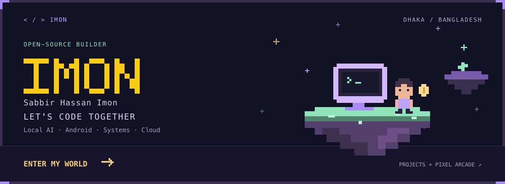
    </picture>
  </a>

  <a href="https://imon.com.bd/" aria-label="Enter IMON World">
    <picture>
      <source media="(prefers-reduced-motion: reduce)" srcset="assets/enter-world.png">
      
    </picture>
  </a>

  
   
  
  

### Choose your world

Pick a scene to open its animated landscape with the time and weather shown.

<table>
  <tr>
    <td align="center" width="33%"><a href="https://imon.com.bd/?scene=waterfall-valley&amp;phase=daylight&amp;weather=wind&amp;view=scenery#scene-stage">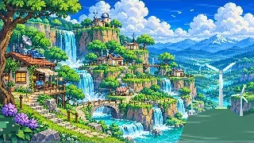 <strong>Waterfall Valley ↗</strong></a> Daylight · Wind</td>
    <td align="center" width="33%"><a href="https://imon.com.bd/?scene=twilight-lake&amp;phase=sunset&amp;weather=clear&amp;view=scenery#scene-stage">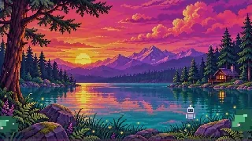 <strong>Twilight Lake ↗</strong></a> Sunset · Clear / calm</td>
    <td align="center" width="33%"><a href="https://imon.com.bd/?scene=neon-forest&amp;phase=twilight&amp;weather=clear&amp;view=scenery#scene-stage"> <strong>Neon Forest ↗</strong></a> Night · Clear / calm</td>
  </tr>
  <tr>
    <td align="center" width="33%"><a href="https://imon.com.bd/?scene=jungle-camp&amp;phase=twilight&amp;weather=clear&amp;view=scenery#scene-stage"> <strong>Jungle Campfire ↗</strong></a> Night · Clear / calm</td>
    <td align="center" width="33%"><a href="https://imon.com.bd/?scene=riverbend-mills&amp;phase=daylight&amp;weather=wind&amp;view=scenery#scene-stage">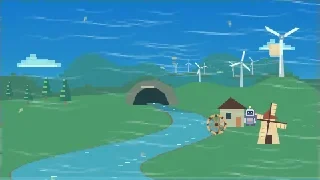 <strong>Riverbend Mills ↗</strong></a> Daylight · Wind</td>
    <td align="center" width="33%"><a href="https://imon.com.bd/?scene=coastal-boardwalk&amp;phase=sunset&amp;weather=clear&amp;view=scenery#scene-stage"> <strong>Sunset Boardwalk ↗</strong></a> Sunset · Clear / calm</td>
  </tr>
</table>

Explore 12 more worlds

<table>
  <tr>
    <td align="center" width="33%"><a href="https://imon.com.bd/?scene=energy-ridge&amp;phase=daylight&amp;weather=wind&amp;view=scenery#scene-stage">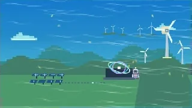 <strong>Energy Ridge ↗</strong></a> Daylight · Wind</td>
    <td align="center" width="33%"><a href="https://imon.com.bd/?scene=islands&amp;phase=morning&amp;weather=clear&amp;view=scenery#scene-stage"> <strong>Floating Islands ↗</strong></a> Morning · Clear / calm</td>
    <td align="center" width="33%"><a href="https://imon.com.bd/?scene=neon-coast&amp;phase=sunset&amp;weather=clear&amp;view=scenery#scene-stage"> <strong>Neon Coast ↗</strong></a> Sunset · Clear / calm</td>
  </tr>
  <tr>
    <td align="center" width="33%"><a href="https://imon.com.bd/?scene=sakura&amp;phase=morning&amp;weather=leaves&amp;view=scenery#scene-stage"> <strong>Cherry Grove ↗</strong></a> Morning · Falling leaves</td>
    <td align="center" width="33%"><a href="https://imon.com.bd/?scene=forest&amp;phase=twilight&amp;weather=fireflies&amp;view=scenery#scene-stage">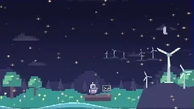 <strong>Woodland ↗</strong></a> Night · Fireflies</td>
    <td align="center" width="33%"><a href="https://imon.com.bd/?scene=beach&amp;phase=daylight&amp;weather=clear&amp;view=scenery#scene-stage"> <strong>Ocean Shore ↗</strong></a> Daylight · Clear / calm</td>
  </tr>
  <tr>
    <td align="center" width="33%"><a href="https://imon.com.bd/?scene=mountains&amp;phase=twilight&amp;weather=aurora&amp;view=scenery#scene-stage">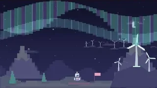 <strong>Alpine Peaks ↗</strong></a> Night · Aurora</td>
    <td align="center" width="33%"><a href="https://imon.com.bd/?scene=desert&amp;phase=sunset&amp;weather=clear&amp;view=scenery#scene-stage">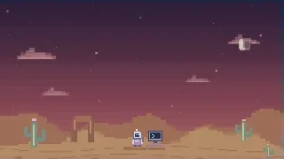 <strong>Canyon Desert ↗</strong></a> Sunset · Clear / calm</td>
    <td align="center" width="33%"><a href="https://imon.com.bd/?scene=cave&amp;phase=twilight&amp;weather=fog&amp;view=scenery#scene-stage">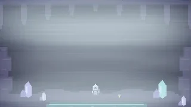 <strong>Crystal Cavern ↗</strong></a> Night · Fog</td>
  </tr>
  <tr>
    <td align="center" width="33%"><a href="https://imon.com.bd/?scene=city&amp;phase=sunset&amp;weather=hail&amp;view=scenery#scene-stage"> <strong>Metro City ↗</strong></a> Sunset · Hailstorm</td>
    <td align="center" width="33%"><a href="https://imon.com.bd/?scene=cyberpunk&amp;phase=twilight&amp;weather=glass-rain&amp;view=scenery#scene-stage"> <strong>Cyberpunk City ↗</strong></a> Night · Rain on glass</td>
    <td align="center" width="33%"><a href="https://imon.com.bd/?scene=space&amp;phase=twilight&amp;weather=meteors&amp;view=scenery#scene-stage"> <strong>Outer Space ↗</strong></a> Night · Meteor shower</td>
  </tr>
</table>

[Browse all 43 scenarios and change the weather in World Studio →](https://imon.com.bd/#worlds)

## IMON · Let’s Code Together

### Hey, I'm Sabbir Hassan Imon 👋

An open-source builder from **Dhaka, Bangladesh**, exploring the space between **local-first AI, Android, systems, and cloud infrastructure**. I like useful tools, curious experiments, and giving serious software a little personality.

### Try a lab

  <a href="https://imon.com.bd/systems.html">
    <picture>
      <source media="(prefers-reduced-motion: reduce)" srcset="docs/art/tower-grid.png">
      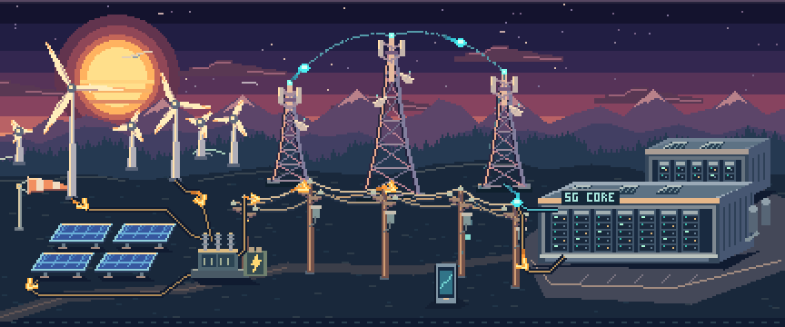
    </picture>
  </a>

  

Follow the yellow power lines from the solar panels and wind turbines, then trace the cyan data packets between towers. Open the Systems Lab to predict what happens when a service loses capacity, or [build your own city grid in Gridworks](https://imon.com.bd/gridworks/).

#### Four ways to practice

<table>
  <tr>
    <td width="50%" valign="top"><a href="https://imon.com.bd/lab.html"> <strong>Code Lab</strong></a> Write HTML, CSS and JavaScript and run your changes in the browser. <a href="https://imon.com.bd/lab.html?exercise=html-remote-date">Build a form with a date window →</a></td>
    <td width="50%" valign="top"><a href="https://imon.com.bd/ai-lab.html">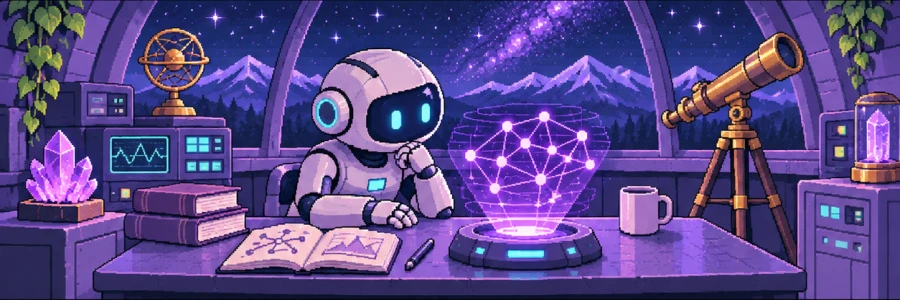 <strong>AI Lab</strong></a> Use Python to inspect data and measure how well a model performs. <a href="https://imon.com.bd/ai-lab.html?exercise=ai-eval-ranking">Score a set of ranked search results →</a></td>
  </tr>
  <tr>
    <td width="50%" valign="top"><a href="https://imon.com.bd/circuits.html">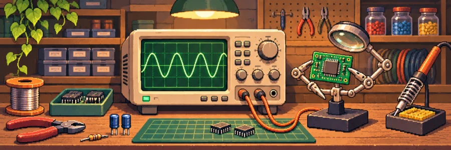 <strong>Circuits &amp; Signals</strong></a> Wire components, predict a reading, then check it on the virtual bench. <a href="https://imon.com.bd/circuits.html?exercise=circuit-bench-bridge">Balance a bridge circuit →</a></td>
    <td width="50%" valign="top"><a href="https://imon.com.bd/systems.html">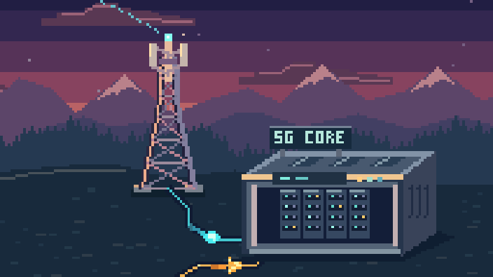 <strong>Systems Lab</strong></a> Change a network or cloud setting and measure the effect on the system. <a href="https://imon.com.bd/systems.html?exercise=capacity-failover">Measure the backlog after a failover →</a></td>
  </tr>
</table>

[Course catalog](https://imon.com.bd/courses.html) · [Practical exams](https://imon.com.bd/exams/) · [Browser tools](https://imon.com.bd/tools/)

#### A closer look at the radio link

  <a href="https://imon.com.bd/systems.html"></a>

The phone is the user equipment (UE). Each tower is a 5G base station (gNB). The arcs illustrate a handover between neighboring base stations, which lets a moving phone stay connected.

### A few things I'm building

  <a href="https://github.com/sabbirimon?tab=repositories">
    <picture>
      <source media="(prefers-reduced-motion: reduce)" srcset="assets/profile-projects.png">
      
    </picture>
  </a>

Meshlit and OmniCast approach the same phone from two directions. Meshlit gives it a local AI workspace. OmniCast brings its screen and controls to a desktop.

| Project | What it explores | Built with |
| :--- | :--- | :--- |
| [**Meshlit**](https://github.com/sabbirimon/meshlit) | Local GGUF models and agents on Android, plus a native desktop workspace for chat and coding. | Kotlin on Android · Rust and JavaScript in Studio |
| [**OmniCast**](https://github.com/sabbirimon/OmniCast) | Mirror, control, and record Android over USB or Wi-Fi, with desktop device tools. | Kotlin |
| [**OmniRecovery**](https://github.com/sabbirimon/OmniRecovery) | Cross-platform data recovery, verified USB acquisition, and forensic inspection. | Rust |
| [**HyperL**](https://github.com/sabbirimon/HyperL) | Memory-budgeted tensor execution, Python graph tools and a desktop inference preview. | Rust · Python |

[Browse my public repositories →](https://github.com/sabbirimon?tab=repositories)

### My toolkit

**Code** &nbsp; `Kotlin` · `Rust` · `Python` · `JavaScript` · `Shell` 
**Infrastructure** &nbsp; `Linux` · `Docker` · `Kubernetes` · `GitHub Actions` 
**Always exploring** &nbsp; Local AI · Android · Cloud · RAN / SDN · GSM / LTE / 5G

### Explore IMON World

| Play or explore | What you’ll find |
| --- | --- |
| [Gridworks](https://imon.com.bd/gridworks/) | Place power stations and network towers, then keep the city connected as its population grows. |
| [Retro arcade](https://imon.com.bd/#arcade) | Play Snake, Surf, 2048 and Rally with touch controls. The [cartridge cabinet](https://imon.com.bd/arcade/) holds Signal Runner, Prism Breaker and Star Patrol. |
| [Pixel landscapes](https://imon.com.bd/#worlds) | Explore 43 scenarios across 18 worlds, or [sit by the jungle campfire](https://imon.com.bd/?scene=jungle-camp&phase=twilight&weather=clear&view=scenery#scene-stage). |
| [Daily Dispatch](https://imon.com.bd/#news) | Read technology, AI and science headlines, or try the daily quiz. |
| [Illustrated player guide](https://imon.com.bd/guide/) | Follow Rafi and his robot through the labs and quests. |

  <a href="https://imon.com.bd/arcade/">
    <picture>
      <source media="(prefers-reduced-motion: reduce)" srcset="assets/profile-arcade-reel.png">
      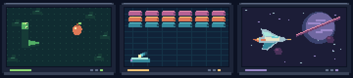
    </picture>
  </a>

Pick a game from the reel. Steer [Snake](https://imon.com.bd/#arcade) toward its next meal, bounce a shot off the paddle in [Prism Breaker](https://imon.com.bd/arcade/?game=breaker), or fly [Star Patrol](https://imon.com.bd/arcade/?game=space).

### Find me around the internet

[LinkedIn](https://linkedin.com/in/sabbirimon) · [Facebook](https://www.facebook.com/mr.sabbirimon/) · [Medium](https://medium.com/@sabbirimon) · [YouTube](https://youtube.com/@sabbirimon) · [X](https://x.com/sabbirimon) · [Buy me a coffee](https://buymeacoffee.com/sabbirimon)

WhatsApp · **@imons**
